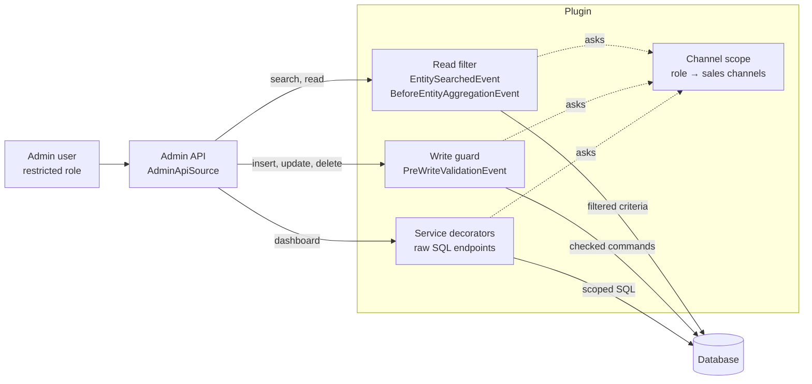

# Sales Channel Scope for Shopware 6

Limit admin roles to sales channels. A user whose role is limited to the *Austria* storefront sees and changes only the orders and customers of that channel: lists, detail pages, search, the dashboard and the API all behave as if the other channels didn't exist.

> **Status: proof of concept (0.2.0).** Built for Shopware 6.7 to show how far sales-channel permissions go with a plugin and without core changes. Iteration 1 covers orders and customers. Not for production use yet; see [Limitations](#limitations).

- [Why](#why)
- [Quick start](#quick-start)
- [The approach](#the-approach)
- [How it works](#how-it-works)
- [Permission preset: Order management](#permission-preset-order-management)
- [Limitations](#limitations)
- [Verified behaviour](#verified-behaviour)
- [Extending it](#extending-it)
- [Development](#development)
- [Roadmap](#roadmap)

## Why

Merchants with several sales channels (brands, countries, B2B and B2C) keep asking for admin users who only work on *their* channel: the Austrian team handles Austrian orders, the B2B team handles B2B customers.

Shopware's ACL can't express that. A role grants privileges per entity type (`order:read`, `customer:update`), never per record, so a user who may read orders reads all orders of all channels.

The core already has the mechanism to filter records, though: `MediaVisibilityRestrictionSubscriber` hides private media by adding a filter to every media search. This plugin uses the same mechanism to add a sales channel filter.

## Quick start

1. Install:

   ```bash
   bin/console plugin:refresh
   bin/console plugin:install --activate MnSalesChannelScope
   bin/build-administration.sh   # only needed when installing from source without the built files
   bin/console cache:clear
   ```

2. Open *Settings → Users & permissions → Roles* and create or edit a role.
3. Click **Add preset: Order management** to give the role everything the order module needs (see [the preset](#permission-preset-order-management)).
4. Pick one or more **Sales channels** for the role and save.
5. Assign the role to a user who is **not** an administrator. Administrators are never limited.

Log in as that user: the order list, customer list, sales channel menu and dashboard only show the chosen channels. Opening an order of another channel by URL shows nothing.

The same from the CLI:

```bash
bin/console mn:channel-scope:preset orders "Order team Austria"
```

The role's sales channels are set on the role page (or through the Admin API, `acl_role.mnSalesChannels`).

## The approach

### Who is limited

A user is limited when **every** role they have is limited to sales channels. Their channels are the union of their roles' channels.

| User or caller | Limited? | Why |
|---|---|---|
| Admin user (`admin = true`) | no | admins can do everything, as in Shopware |
| User whose roles all have sales channels | **yes**, to the union of those channels | |
| User with at least one role without sales channels | no | a role without channels means "all channels", as before the plugin |
| Integration (API key) | no | not covered in iteration 1 |
| Storefront, Store API, CLI | no | not an admin user |
| Work in system scope (indexing, scheduled tasks, flows, internal reads) | no | runs on behalf of Shopware, not of a user |

Nothing changes for existing setups: until a role gets sales channels, the plugin does nothing.

### How each entity belongs to a sales channel

Only orders belong to exactly one sales channel. Everything else is shared or linked indirectly, so the rule distinguishes **seeing** a record from **changing** it.

| Entity | Link to the sales channel | Sees it | Changes it | Iteration |
|---|---|---|---|---|
| Orders | `order.salesChannelId`, exactly one | its channel is the user's | its channel is the user's, and it can't move to another channel | **1** |
| Order details (line items, deliveries, transactions, addresses, order customer, documents) | through their order | as their order | as their order | **1** |
| Customers | `salesChannelId` (registered in) and optional `boundSalesChannelId`; unbound customers can log in to every channel | registered in, bound to **or ordered in** one of the user's channels | registered in or bound to one of the user's channels | **1** |
| Customer addresses | through their customer | as their customer | as their customer | **1** |
| Sales channels | the channel itself | the user's channels | update own channels only; never create or delete | **1** |
| Products | `product_visibility`, many to many; variants inherit | visible in one of the user's channels | all of its channels are the user's, otherwise read-only | 2 |
| Categories | none; channels point to entry categories, `category.path` holds the tree | below an entry category of the user's channels | the tree is used only by the user's channels | 2 |
| Shopping Experiences | none; used by categories, products, landing pages and per-channel defaults | used by something the user sees | used only within the user's channels | 2 |

Customers are the subtle case. A customer registered in channel B who also ordered in channel A is visible to the team of channel A, because they handle that customer's orders in A. But only the team of channel B may change the customer, because the account belongs to channel B.

### Where to enforce it

A plugin can't change the ACL itself, but it can hook into the data layer that every admin screen, the Admin API and the Sync API go through:



- **Read filter:** filtering on the data layer instead of the UI means a hidden record is also hidden from search, the API, exports through the repository and every other screen.
- **Write guard:** checks every insert, update and delete before it's written, using the stored record (who it belongs to now) and the payload (who it would belong to afterwards).
- **Service decorators:** some endpoints bypass the data layer with raw SQL. Each one needs its own decorator; the dashboard turnover chart is the first.

## How it works

### Role mapping

The table `mn_acl_role_sales_channel` maps ACL roles to sales channels. `AclRoleExtension` adds it to the role as the many-to-many association `acl_role.mnSalesChannels`, so the role page loads and saves it with the role.

### Channel scope

`ChannelScope::salesChannelIds(Context)` answers one question for every other part: which sales channels may this caller see? It returns a list of ids, or `null` for unrestricted (see [Who is limited](#who-is-limited)). Roles are loaded once per user and request.

### Read filter

`ReadFilterSubscriber` listens to `EntitySearchedEvent` and `BeforeEntityAggregationEvent`, which Shopware dispatches for every repository search, id search and aggregation. For a limited user it adds the entity's rule from `ScopeRules` as a filter:

| Entity | Filter |
|---|---|
| `sales_channel` | `id IN (user's channels)` |
| `order` | `salesChannelId IN (…)` |
| `order_line_item`, `order_delivery`, `order_transaction`, `order_address`, `order_customer`, `document` | `order.salesChannelId IN (…)` |
| `customer` | `salesChannelId IN (…) OR boundSalesChannelId IN (…) OR orderCustomers.order.salesChannelId IN (…)` |
| `customer_address` | the customer rule, prefixed with `customer.` |

Associations need extra care: Shopware loads to-many associations (a customer's addresses, an order's line items) without dispatching a search event of their own. The subscriber therefore walks the criteria's associations and adds the same rules to every to-many association, at any depth. Many-to-one and one-to-one associations are joins and can't take a filter; their own entity is filtered whenever it's searched directly.

### Write guard

`WriteGuardSubscriber` listens to `PreWriteValidationEvent`, which carries every command of a write (also Sync API batches and order versions). For a limited user it refuses:

- changes to orders, or their details, whose order belongs to another channel;
- new orders in, or moves of orders to, another channel;
- changes to customers and their addresses unless the customer is registered in or bound to one of the user's channels, and registering or binding customers to other channels;
- creating or deleting sales channels, and updating channels that aren't the user's;
- any change to the role-to-channel mapping.

Records inserted in the same write (a new order with its line items, a new customer with addresses) are checked against each other, so creating them together works. Stored values are read with `DbalScopeLookup`.

A refusal is reported as Shopware's write error (HTTP 400) containing:

```json
{ "code": "MN_CHANNEL_SCOPE__WRITE_DENIED", "detail": "Your role may not change this order: the order belongs to another sales channel" }
```

### Dashboard

The dashboard's turnover chart comes from `OrderAmountService`, which queries the `order` table with raw SQL and would ignore the read filter. `ScopedOrderAmountService` decorates it and adds `sales_channel_id IN (…)` for limited users; everyone else gets Shopware's own result.

### Administration

- `sw-users-permissions-role-detail`: loads the role with its `mnSalesChannels`.
- `sw-users-permissions-role-view-general`: the sales channel picker and the preset button.

## Permission preset: Order management

Shopware's order permissions don't cover everything the order module does:

| What you do in the order module | What it needs | Where Shopware puts it |
|---|---|---|
| See, create, send documents | `document.viewer` | *Settings → Documents*, not *Orders* |
| Delete a document | `document.deleter` (UI check) and `document:delete` | `document.deleter` only grants `document_base_config:delete`; `document:delete` is in no role |
| Send a document or order mail | `api_send_email` | only with *Mail templates → edit* |
| Change the payment status | `order_transaction:update` | not part of *Orders → edit* |
| Refund | capture and refund position privileges | partly missing |
| Document files (document generation v2) | `document_file:*` | in no role |

The preset `src/Resources/config/presets/orders.json` puts all of it in one place:

- **`roles`**: the admin roles to tick: order viewer, editor, creator, deleter; refund viewer, editor, creator, deleter; discounts; document viewer and deleter.
- **`additionalPrivileges`**: the privileges no role grants, each with the reason it's needed.
- **`expandedPrivileges`**: the entity privileges the roles expand to, as the administration expands them when saving. The CLI command needs them to write a complete role.

Apply it on the role page (**Add preset: Order management**, then save) or with `bin/console mn:channel-scope:preset orders "<role name or id>"`. Both only add permissions; nothing is removed.

Note that `document.deleter` also allows deleting document settings in *Settings → Documents*. The order module only offers deleting documents with it.

After a Shopware update, check whether the order or document permissions changed:

```bash
node bin/expand-preset.js src/Resources/config/presets/orders.json /path/to/shop
```

and copy `privileges` into `expandedPrivileges`.

## Limitations

| Gap | Effect | Planned fix |
|---|---|---|
| Products, categories, Shopping Experiences, promotions, reviews, newsletter recipients, per-channel settings | not limited yet | iteration 2 |
| Many-to-one joins | a joined record is still shown where another entity references it (for example a review's customer) | filter the root entity; accept the joined label |
| Other raw SQL endpoints (statistics, reports) | may show figures of all channels | decorate one by one |
| Admin search hit counts | results are filtered, counts unchecked | check and fix |
| Import/Export, Flow Builder, mail previews | not checked | iteration 2 |
| Integrations (API keys) | never limited | own channel setting for integrations |
| Commercial features (B2B, Return Management, Subscriptions, Multi-Warehouse) | their entities are not limited | iteration 3 |
| Performance | the customer rule adds two joins (`orderCustomers.order`) per customer search | cache or denormalise if needed |

## Verified behaviour

Checked on Shopware 6.7.16 with two storefront channels and one limited role per channel, through the Admin API:

| Check | Result for each role |
|---|---|
| Order list | only the orders of the role's channel |
| Customer list | customers registered in, bound to or ordered in the role's channel |
| Sales channels | only the role's channel |
| Order of the other channel by id | not found (404) |
| Changing an order of the other channel | refused (`MN_CHANNEL_SCOPE__WRITE_DENIED`) |
| Dashboard turnover | only the role's channel |
| Document types, document settings, mail templates (preset) | readable |

Not verified yet: creating, sending and deleting a document end to end, and every screen of the administration as a limited user.

## Extending it

**Limit another entity.** Add its read rule to `ScopeRules::readFilter()` and its write rule to `WriteGuardSubscriber::deny()`. If the entity is a child of an order, adding it to `ScopeRules::ORDER_CHILDREN` covers both, as long as its table has `order_id` and `order_version_id`.

**Change a rule.** `ScopeRules` and the subscribers are plain services; decorate or replace them in your own plugin's service configuration.

**Add a preset.** Put another JSON file next to `orders.json`, import it in `src/Resources/app/administration/src/extension/sw-users-permissions-role-view-general/index.js`, and add its name and help text to the snippets.

## Development

```
src/
  Scope/        ChannelScope, RoleChannelLoader, ScopeRules: who may see what
  Subscriber/   ReadFilterSubscriber, WriteGuardSubscriber
  Write/        ScopeLookup: stored channels of records that change
  Dashboard/    ScopedOrderAmountService
  Entity/, Extension/, Migration/   role-to-channel mapping
  Preset/, Command/                 permission presets
  Resources/config/presets/         preset files
  Resources/app/administration/     role page extensions
bin/expand-preset.js                regenerates a preset's expanded privileges
tests/Unit/                         unit tests (no database needed)
```

Unit tests run against an existing Shopware installation:

```bash
SHOPWARE_DIR=/path/to/shop php phpunit.phar --testsuite unit
```

After changing the administration sources, run `bin/build-administration.sh` in a Shopware installation and commit the built files in `src/Resources/public`.

## Roadmap

1. **Iteration 1 (done):** orders, order details, customers, sales channels, dashboard, order preset.
2. **Iteration 2:** products (visibility, read-only when shared), categories (entry-point trees), Shopping Experiences ("duplicate to edit" for shared layouts), promotions, reviews, newsletter recipients, per-channel settings, more raw SQL endpoints, Import/Export.
3. **Iteration 3:** Commercial features and integrations with their own channel scope.

Open questions for merchants: should "ordered in the channel" make a customer visible? Should limited users change channel settings? Should integrations get the same limits?

## License

MIT, see [LICENSE](LICENSE).
