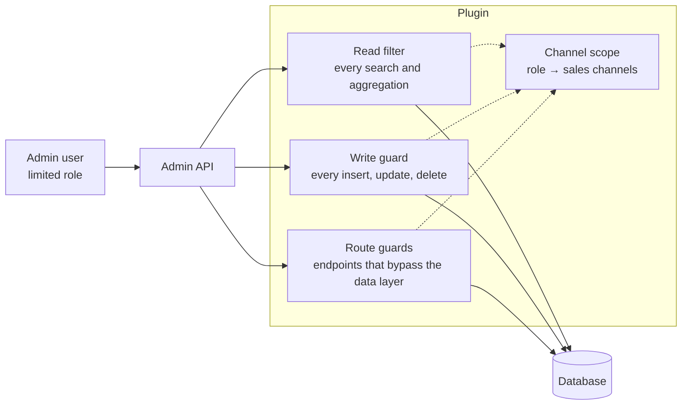

# Sales Channel Scope for Shopware 6

Limit admin roles to sales channels. A user whose role is limited to the *Austria* storefront sees and changes only what belongs to that channel: its orders, customers, products, categories, layouts, promotions and settings. Lists, detail pages, search, the dashboard and the Admin API all behave as if the other channels didn't exist; records shared with other channels are read-only.

> **Status: proof of concept (0.12).** Built for Shopware 6.7 to show how far sales channel permissions go with a plugin and without core changes. Not for production use yet; see [limitations](#limitations).

[](https://github.com/mnaczenski/MnSalesChannelScope/actions/workflows/tests.yml)

## Why

Merchants with several sales channels (brands, countries, B2B and B2C) want admin users who only work on *their* channel. Shopware's ACL can't express that: a role grants privileges per entity type (`order:read`), never per record, so a user who may read orders reads the orders of all channels.

The data layer can filter records, though: Shopware's own `MediaVisibilityRestrictionSubscriber` hides private media by adding a filter to every media search. This plugin uses the same mechanism for sales channels, and guards every write and the few endpoints that bypass the data layer.

## What a limited user gets

| Area | Sees | Changes |
|---|---|---|
| Orders and their details | orders of their channels | the same |
| Customers | customers registered in, bound to or ordered in their channels | customers registered in or bound to their channels |
| Products, reviews | products sold in their channels, their reviews | products sold only in their channels; shared products are read-only |
| Categories | the category trees of their channels | categories used only by their channels |
| Shopping Experiences, landing pages | layouts and landing pages used in their channels | those used only in their channels; new layouts belong to them |
| Promotions | promotions of their channels | promotions assigned only to their channels |
| Sales channels and their settings | their channels, per-channel settings | the same; settings for all channels stay with administrators |
| Dashboard | turnover of their channels | – |

Totals Shopware stores across channels (a customer's order count, a product's rating) are shown for the user's channels. Details per entity: [docs/architecture.md](docs/architecture.md).

## Quick start

Requires Shopware 6.7.14 or newer 6.7 releases and PHP 8.2 or newer ([compatibility policy](docs/compatibility.md)).

1. Install:

   ```bash
   bin/console plugin:refresh
   bin/console plugin:install --activate MnSalesChannelScope
   bin/console cache:clear
   ```

2. Open *Settings → Users & permissions → Roles* and create or edit a role.
3. Under *Basic information*, pick the role's **Sales channels**.
4. In the *Permission presets* card, add what the team needs, for example *Order management*, then save.
5. Assign the role to a user who is **not** an administrator. Administrators, and users with any role without sales channels, are never limited.

Log in as that user: lists, menus and the dashboard only show the chosen channels; records of other channels can't be opened, also not by URL or through the API.

From the command line:

```bash
bin/console mn:channel-scope:preset orders "Order team Austria"
```

## Permission presets

Shopware's permissions don't map one to one to its modules: the order module needs document, mail and payment state permissions that live elsewhere. A preset adds everything a module needs in one click and never removes anything.

| Preset | For |
|---|---|
| Order management | orders, documents, refunds, discounts, payment states |
| Product management | products, media, layouts, bundles, review summaries, the Reviews module |
| Category management | categories, their layouts, SEO settings and product assignments |
| Marketing | promotions and Shopping Experiences |
| Shopping Experiences | layouts only |
| Sales channel settings | the role's own sales channels and the settings pages with a sales channel switch |

More in [docs/presets.md](docs/presets.md); other plugins can add their own presets.

## How it works



- **Channel scope:** which sales channels a user may work with, from their roles (`mn_acl_role_sales_channel`).
- **Read filter:** adds a sales channel filter to every repository search, aggregation and to-many association of a limited user.
- **Write guard:** checks every write command against what the record belongs to now and what it would belong to afterwards.
- **Route guards:** for endpoints that work with plain SQL or in the system scope (settings, clone, customer login, theme assignment, promotion codes, dashboard).
- **Administration:** marks shared records read-only (as for a view-only user), pre-selects the user's channels for new records, hides what doesn't apply. It only helps the user; the server enforces every rule.

## Documentation

- [Architecture](docs/architecture.md): who is limited, how each entity belongs to a sales channel, every guard and why it is needed
- [Permission presets](docs/presets.md): what each preset grants, the file format, keeping presets up to date
- [Extending](docs/extending.md): limit your own entities, add presets and settings pages, use the scope in your administration modules
- [Testing](docs/testing.md): unit tests, static analysis, CI and a manual acceptance checklist
- [Changelog](CHANGELOG.md)

## Limitations

The most important open points; the full list is in [docs/architecture.md](docs/architecture.md#limitations).

- **Integrations (API keys)** are never limited.
- **Commercial features** (B2B, Return Management, Subscriptions, Multi-Warehouse) and **Flow Builder** are not limited.
- **Filtering and sorting** by customer or product totals still use Shopware's totals across all channels.
- **Some screens** offer actions the server refuses (category tree menus, product bulk edit, layout list actions); the change is refused with `MN_CHANNEL_SCOPE__WRITE_DENIED`.
- **Rules** created by a limited user can't be changed afterwards.

## Development

```bash
composer install            # Shopware and the dev tools, no shop needed
composer test               # PHPUnit
composer phpstan            # PHPStan, level 8
composer test:js            # administration services (node 20+)
```

Against a running shop, `tests/acceptance/leak-check.php` logs in as a limited user and looks for another channel's records ([leak check](docs/testing.md#leak-check)).

After changing the administration sources, build them in a Shopware installation (`bin/build-administration.sh`) and commit the files in `src/Resources/public`. See [docs/testing.md](docs/testing.md).

## License

MIT, see [LICENSE](LICENSE).
