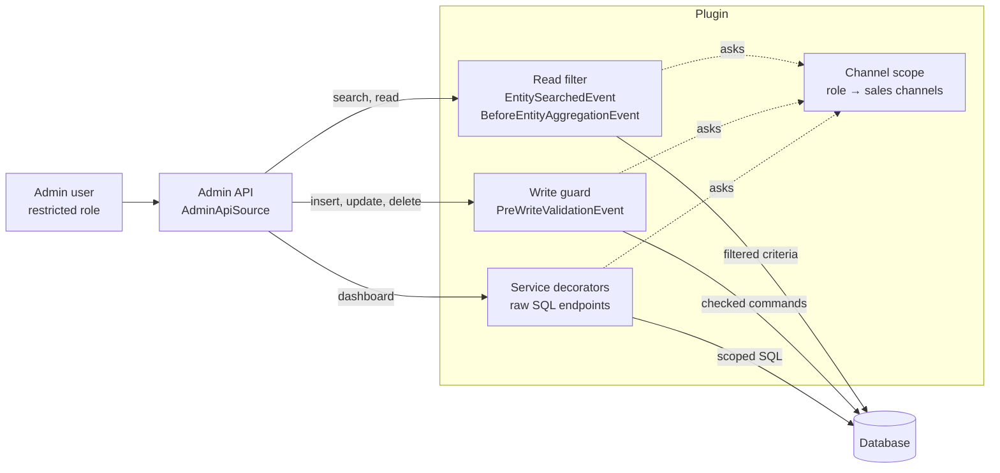

# Sales Channel Scope for Shopware 6

Limit admin roles to sales channels. A user whose role is limited to the *Austria* storefront sees and changes only the orders and customers of that channel: lists, detail pages, search, the dashboard and the API all behave as if the other channels didn't exist.

> **Status: proof of concept (0.3.0).** Built for Shopware 6.7 to show how far sales-channel permissions go with a plugin and without core changes. Covered so far: orders, customers, products and categories. Not for production use yet; see [Limitations](#limitations).

- [Why](#why)
- [Quick start](#quick-start)
- [The approach](#the-approach)
- [How it works](#how-it-works)
- [Permission preset: Order management](#permission-preset-order-management)
- [Limitations](#limitations)
- [Verified behaviour](#verified-behaviour)
- [Extending it](#extending-it)
- [Development](#development)
- [Roadmap](#roadmap)

## Why

Merchants with several sales channels (brands, countries, B2B and B2C) keep asking for admin users who only work on *their* channel: the Austrian team handles Austrian orders, the B2B team handles B2B customers.

Shopware's ACL can't express that. A role grants privileges per entity type (`order:read`, `customer:update`), never per record, so a user who may read orders reads all orders of all channels.

The core already has the mechanism to filter records, though: `MediaVisibilityRestrictionSubscriber` hides private media by adding a filter to every media search. This plugin uses the same mechanism to add a sales channel filter.

## Quick start

1. Install:

   ```bash
   bin/console plugin:refresh
   bin/console plugin:install --activate MnSalesChannelScope
   bin/build-administration.sh   # only needed when installing from source without the built files
   bin/console cache:clear
   ```

2. Open *Settings → Users & permissions → Roles* and create or edit a role.
3. Click **Add preset: Order management** to give the role everything the order module needs (see [the preset](#permission-preset-order-management)).
4. Pick one or more **Sales channels** for the role and save.
5. Assign the role to a user who is **not** an administrator. Administrators are never limited.

Log in as that user: the order list, customer list, sales channel menu and dashboard only show the chosen channels. Opening an order of another channel by URL shows nothing.

The same from the CLI:

```bash
bin/console mn:channel-scope:preset orders "Order team Austria"
```

The role's sales channels are set on the role page (or through the Admin API, `acl_role.mnSalesChannels`).

## The approach

### Who is limited

A user is limited when **every** role they have is limited to sales channels. Their channels are the union of their roles' channels.

| User or caller | Limited? | Why |
|---|---|---|
| Admin user (`admin = true`) | no | admins can do everything, as in Shopware |
| User whose roles all have sales channels | **yes**, to the union of those channels | |
| User with at least one role without sales channels | no | a role without channels means "all channels", as before the plugin |
| Integration (API key) | no | not covered in iteration 1 |
| Storefront, Store API, CLI | no | not an admin user |
| Work in system scope (indexing, scheduled tasks, flows, internal reads) | no | runs on behalf of Shopware, not of a user |

Nothing changes for existing setups: until a role gets sales channels, the plugin does nothing.

### How each entity belongs to a sales channel

The principle: **with a scope, you only see what is connected to your sales channels.** Only orders belong to exactly one sales channel. Everything else is shared or linked indirectly, so the rule distinguishes **seeing** a record from **changing** it: a record that is also connected to other channels is read-only.

| Entity | Link to the sales channel | Sees it | Changes it | Iteration |
|---|---|---|---|---|
| Orders | `order.salesChannelId`, exactly one | its channel is the user's | its channel is the user's, and it can't move to another channel | **1** |
| Order details (line items, deliveries, transactions, addresses, order customer, documents) | through their order | as their order | as their order | **1** |
| Customers | `salesChannelId` (registered in) and optional `boundSalesChannelId`; unbound customers can log in to every channel | registered in, bound to **or ordered in** one of the user's channels | registered in or bound to one of the user's channels | **1** |
| Customer addresses | through their customer | as their customer | as their customer | **1** |
| Sales channels | the channel itself | the user's channels | update own channels only; never create or delete | **1** |
| What a sales channel offers (countries, currencies, languages, payment and shipping methods, translations, theme), analytics, product comparison | `sales_channel_id`, or the channel that uses it (analytics) | of the user's channels | of the user's channels | **2** |
| Themes | `theme_sales_channel` | all (they are listed for every channel) | assigned only to the user's channels | **2** |
| Products | `product_visibility`, many to many; variants inherit their parent's | sold in one of the user's channels | sold only in the user's channels, otherwise read-only; the user's own channel visibilities can always change | **2** |
| Product details (prices, media, visibilities, configurator, cross-selling, downloads, search keywords) | through their product | as their product | as their product | **2** |
| Product reviews | `product_review.salesChannelId` | its channel is the user's | its channel is the user's | **2** |
| Review summaries (Commercial) | `product_review_summary.salesChannelId` | its channel is the user's | its channel is the user's | **2** |
| Categories | none; channels point to entry categories (navigation, footer, service), `category.path` holds the ancestors | in a tree of one of the user's channels, plus the ancestors of their entry categories; other trees and trees outside every channel are hidden | it belongs to the user's channels only; shared trees and ancestors are read-only | **2** |
| Sales channel settings (configuration values, SEO URLs, domains) | `salesChannelId`, or none for values that apply to all channels | of the user's channels, and those for all channels | of the user's channels only | hardening |
| Shopping Experiences | none; used by categories, products, landing pages and default layout settings | used in one of the user's channels, created by the user's channels and still unused, or one of Shopware's locked layouts | used only within the user's channels (locked layouts never) | **2** |
| Landing pages | `landing_page_sales_channel`, many to many | shown in one of the user's channels | shown only in the user's channels | **2** |

Customers are the subtle case. A customer registered in channel B who also ordered in channel A is visible to the team of channel A, because they handle that customer's orders in A. But only the team of channel B may change the customer, because the account belongs to channel B.

### Where to enforce it

A plugin can't change the ACL itself, but it can hook into the data layer that every admin screen, the Admin API and the Sync API go through:



- **Read filter:** filtering on the data layer instead of the UI means a hidden record is also hidden from search, the API, exports through the repository and every other screen.
- **Write guard:** checks every insert, update and delete before it's written, using the stored record (who it belongs to now) and the payload (who it would belong to afterwards).
- **Service decorators:** some endpoints bypass the data layer with raw SQL. Each one needs its own decorator; the dashboard turnover chart is the first.

## How it works

### Role mapping

The table `mn_acl_role_sales_channel` maps ACL roles to sales channels. `AclRoleExtension` adds it to the role as the many-to-many association `acl_role.mnSalesChannels`, so the role page loads and saves it with the role.

### Channel scope

`ChannelScope::salesChannelIds(Context)` answers one question for every other part: which sales channels may this caller see? It returns a list of ids, or `null` for unrestricted (see [Who is limited](#who-is-limited)). Roles are loaded once per user and request.

### Read filter

`ReadFilterSubscriber` listens to `EntitySearchedEvent` and `BeforeEntityAggregationEvent`, which Shopware dispatches for every repository search, id search and aggregation. For a limited user it adds the entity's rule from `ScopeRules` as a filter:

| Entity | Filter |
|---|---|
| `sales_channel` | `id IN (user's channels)` |
| `order` | `salesChannelId IN (…)` |
| `order_line_item`, `order_delivery`, `order_transaction`, `order_address`, `order_customer`, `document` | `order.salesChannelId IN (…)` |
| `customer` | `salesChannelId IN (…) OR boundSalesChannelId IN (…) OR orderCustomers.order.salesChannelId IN (…)` |
| `customer_address` | the customer rule, prefixed with `customer.` |
| `product` | `visibilities.salesChannelId IN (…) OR parent.visibilities.salesChannelId IN (…)` (variants usually have no visibilities of their own) |
| `product_price`, `product_media`, `product_visibility`, `product_configurator_setting`, `product_cross_selling`, `product_download`, `product_search_keyword` | the product rule, prefixed with `product.` |
| `product_review`, `main_category` | `salesChannelId IN (…)` |
| `category` | `id IN (entry categories and their ancestors) OR path CONTAINS '\|<entry>\|'` for each entry category of the user's channels (`CategoryTrees`) |

Associations need extra care: Shopware loads to-many associations (a customer's addresses, an order's line items) without dispatching a search event of their own. The subscriber therefore walks the criteria's associations and adds the same rules to every to-many association, at any depth. Many-to-one and one-to-one associations are joins and can't take a filter; their own entity is filtered whenever it's searched directly.

### Write guard

`WriteGuardSubscriber` listens to `PreWriteValidationEvent`, which carries every command of a write (also Sync API batches and order versions). For a limited user it refuses:

- changes to orders, or their details, whose order belongs to another channel;
- new orders in, or moves of orders to, another channel;
- changes to customers and their addresses unless the customer is registered in or bound to one of the user's channels, and registering or binding customers to other channels;
- creating or deleting sales channels, and updating channels that aren't the user's;
- any change to the role-to-channel mapping;
- changes to products sold in other channels too (shared products are read-only), and to their prices, media, categories, properties, options, tags, configurator settings, cross-sellings, downloads and search keywords;
- new products without a visibility in one of the user's channels, and new variants of products the user doesn't own;
- visibilities and main categories of other channels, and visibilities for products the user can't see (hidden products stay hidden);
- changes to product reviews of other channels.

- changes to categories (and their translations and tags) that also belong to other channels' trees or are only ancestors of the user's entry categories; new categories below such categories, and root categories; deleting or moving a subtree that holds another channel's entry category;
- assigning products to categories the user can't see; setting a sales channel's entry categories to categories the user may not edit;
- configuration values (`system_config`), SEO URLs and domains of other channels, and those that apply to all channels.

Visibilities of the user's own channels may change on every product they see, also on shared ones: adding or removing a product from their own channel is their call.

Records inserted in the same write (a new order with its line items, a new customer with addresses) are checked against each other, so creating them together works. Stored values are read with `DbalScopeLookup`.

A refusal is reported as Shopware's write error (HTTP 400) containing:

```json
{ "code": "MN_CHANNEL_SCOPE__WRITE_DENIED", "detail": "Your role may not change this order: the order belongs to another sales channel" }
```

### Paths around the data layer

A few core endpoints check records without the search events the read filter hooks into. Each one needs its own guard:

| Endpoint | Gap | Guard |
|---|---|---|
| *Log in as customer* (`POST /api/_proxy/generate-imitate-customer-token`) | validates the customer and channel with a raw existence check: a limited user got a storefront login for another channel's customer | `ImitateCustomerGuardSubscriber` adds constraints to the request's validation (`framework.validation.impersonation.generate-token`): the channel must be the user's, the customer registered in or bound to one of the user's channels |
| Dashboard turnover | raw SQL | `ScopedOrderAmountService`, see below |
| Admin search (`POST /api/_admin/search`) | none: it searches through the repositories | – |
| Clone (`POST /api/_action/clone/{entity}/{id}`) | reads the source without search events and writes the copy in the system scope: hidden records could be copied, the write guard doesn't see the copy | `CloneGuardSubscriber`: the source must be visible to the user, a product sold in their channels only; copies of layouts belong to their channels |
| Theme assignment and configuration (`/api/_action/theme/...`) | the assignment marks the pending theme with plain SQL and may switch after an asynchronous compilation; configuration routes check no privilege | `ThemeGuardSubscriber`: assign only to the user's channels; configure only themes used by their channels only |
| Order state transitions | none: the state machine reads the order through the repository, other channels' orders are "not found" | – |
| Store API proxy and admin order creation (`/api/_proxy/...`, `/api/_proxy-order/...`) | none: the channel is read through the repository | – |
| Import/Export | the presets don't grant it; an export job runs with the user's context, so the read filter applies (not tested end to end) | – |
| Admin search with OpenSearch (`SHOPWARE_ADMIN_ES_ENABLED`) | results are loaded through the repository and filtered, but the hit count comes from the search index (not tested) | count visible hits |

### Shopping Experiences

A layout has no sales channel of its own. `CmsPages` derives them from what uses it (`DbalCmsUsageSource`, one set of queries per request):

- categories: the channels whose trees hold the category (see categories);
- products and variants: their visibilities (a variant without its own uses its parent's);
- landing pages: their sales channels;
- default layout settings (`core.cms.default_*`): all channels, or the one they are set for;
- owners: a layout created by a limited user belongs to that user's channels (`mn_cms_page_sales_channel`, recorded when it is written). This keeps a new, still unused layout visible to its team, and copies of shared layouts too.

Visible: Shopware's locked layouts and layouts with one of the user's channels; layouts nobody uses that an unrestricted user created are hidden. Editable: not locked and only the user's channels. The read filter limits `cms_page` and, through their layout, `cms_section`, `cms_block` and `cms_slot`. `CmsGuardSubscriber` checks every write to a layout, its parts and translations (also parts inserted in the same write, and parts moved to another layout), and refuses assigning layouts the user can't see to categories, products and landing pages. In the editor, a shared layout behaves like a locked one.

### Totals

Shopware stores some totals across all sales channels: on the customer `orderCount`, `orderTotalAmount`, `lastOrderDate` and `reviewCount`, on the product `ratingAverage` and `sales`. For a limited user, `ChannelTotalsSubscriber` replaces them when customers or products are loaded with the same totals counted in the user's channels only (`DbalChannelTotals`, same rules as Shopware: completed orders, approved reviews, orders that are not cancelled). Filtering and sorting by these fields still use the stored totals.

### Dashboard

The dashboard's turnover chart comes from `OrderAmountService`, which queries the `order` table with raw SQL and would ignore the read filter. `ScopedOrderAmountService` decorates it and adds `sales_channel_id IN (…)` for limited users; everyone else gets Shopware's own result.

### Administration

- `sw-users-permissions-role-detail`: loads the role with its `mnSalesChannels`.
- `sw-users-permissions-role-view-general`: the sales channel picker and the preset button.
- `sw-product-detail`: shared products show a "Shared product: read-only" hint, and saving and every field are disabled: while a shared product is open, Shopware's `acl` service denies the product editor, creator and deleter roles (`registerReadOnlyGuard`), so Shopware's own fields disable themselves as for a view-only user. New products start with the user's own sales channels selected: the default sales channels (*Settings → Products*) that are the user's, or all of the user's channels when none of the defaults is theirs.
- `sw-category-detail` and `sw-category-view`: shared categories show a "Shared category: read-only" hint above the tabs, and saving and every field are disabled the same way.
- `sw-admin-menu`: limited users without the *Sales channel settings* preset don't see the *Settings* entry (Shopware shows it to every user). Settings pages outside the preset redirect to the dashboard, also when opened by URL.
- `sw-settings-index`: limited users only see the tiles of the preset's pages.
- `sw-sales-channel-switch`: limited users get no *All Sales Channels* option; the switch starts with their first channel.
- `sw-system-config` and `sw-seo-url-template-card`: load the values and templates "for all sales channels" before a channel's own (they are shown as inherited values and are the blueprint for a channel's templates). Shopware relies on the switch starting with *All Sales Channels*.
- `sw-settings-seo`: hides the "redirect to canonical URL" card for limited users (it has no sales channel switch and always saves the value for all channels).
- `GET /api/_action/mn-channel-scope/me` returns `{ restricted, salesChannelIds, categoryEntryPoints: { own, foreign } }` for these screens. It only drives the UI; the server enforces the rules.

## Permission preset: Order management

Shopware's order permissions don't cover everything the order module does:

| What you do in the order module | What it needs | Where Shopware puts it |
|---|---|---|
| See, create, send documents | `document.viewer` | *Settings → Documents*, not *Orders* |
| Delete a document | `document.deleter` (UI check) and `document:delete` | `document.deleter` only grants `document_base_config:delete`; `document:delete` is in no role |
| Send a document or order mail | `api_send_email` | only with *Mail templates → edit* |
| Change the payment status | `order_transaction:update` | not part of *Orders → edit* |
| Refund | capture and refund position privileges | partly missing |
| Document files (document generation v2) | `document_file:*` | in no role |

The preset `src/Resources/config/presets/orders.json` puts all of it in one place:

- **`roles`**: the admin roles to tick: order viewer, editor, creator, deleter; refund viewer, editor, creator, deleter; discounts; document viewer and deleter.
- **`additionalPrivileges`**: the privileges no role grants, each with the reason it's needed.
- **`expandedPrivileges`**: the entity privileges the roles expand to, as the administration expands them when saving. The CLI command needs them to write a complete role.

Apply it on the role page (**Add preset: Order management**, then save) or with `bin/console mn:channel-scope:preset orders "<role name or id>"`. Saving on the role page lets the administration expand the roles itself; the command uses `expandedPrivileges`. Both only add permissions; nothing is removed.

Note that `document.deleter` also allows deleting document settings in *Settings → Documents*. The order module only offers deleting documents with it.

**Shopping Experiences** (`cms.json`) adds the layout roles (viewer, editor, creator, deleter). Note that Shopware's layout editor role also grants `category:update` and `landing_page:update` (for assigning layouts); the write guard limits both to the user's channels.

Two more presets: **Category management** (`categories.json`) adds the category roles with layouts, SEO and product assignments, and **Product management** (`products.json`) adds the product roles (viewer, editor, creator, deleter) with everything they pull in: media, Shopping Experience layouts and the Commercial extensions of the product page (bundles, review summaries), plus the review roles (viewer, editor, deleter) for *Catalogue → Reviews*.

## Permission preset: Sales channel settings

Shopware keeps one set of configuration values per sales channel, with the values "for all sales channels" as the fallback. The preset `settings.json` gives a limited user the settings pages that have a sales channel switch, for their own channels:

| Page | Configuration domain |
|---|---|
| Basic information | `core.basicInformation` |
| Cart | `core.cart` |
| Login & registration | `core.loginRegistration` |
| Newsletter | `core.newsletter` |
| Sitemap | `core.sitemap` |
| SEO | URL templates (`seo_url_template`) of their channels; the "redirect to canonical URL" card applies to all channels and is hidden |

The preset also includes Shopware's sales channel viewer and editor roles, so the role's own channels appear under *Sales Channels* in the main menu (the list is filtered to them). The write guard limits everything the sales channel page changes to those channels; creating and deleting sales channels stays with unrestricted users.

The pages need Shopware's *Settings* role (`system.system_config`), which is not limited to channels or pages. The plugin narrows it down:

- **Settings API** (`SystemConfigGuardSubscriber`): the pages read and save through `/api/_action/system-config`, which writes with plain SQL and bypasses the write guard. For a limited user, a request may only read Shopware's own settings (`core.*`) of their channels or for all channels (shown as inherited values). Credentials and installation-wide settings are hidden (mailer, store and license, apps, services, updates, usage data, webhooks, see `ConfigRules::HIDDEN_DOMAINS`), and so are plugin settings. It may only save the domains in the table above, and only for their own channels. A refusal is HTTP 403 with `MN_CHANNEL_SCOPE__SETTINGS_DENIED`.
- **Entity API**: the read filter applies the same rule to `system_config` records; the write guard refuses other domains, values for all channels, and product sortings (the role grants them for the listing page, but they apply to all channels). SEO URL templates are treated like other channel settings.
- **Administration**: only the preset's pages appear in the settings overview, the others redirect to the dashboard, and the channel switch has no *All Sales Channels* option.

On the SEO page, the URL templates are saved through the entity API (the write guard allows only the user's channels, not the defaults for all channels). Template previews, canonical URLs and custom URLs read the sales channel through the repository, so other channels are "not found".

Pages that aren't per channel, or that change records shared by all channels (listing sortings, documents, number ranges, plugin configuration), stay with unrestricted users.

After a Shopware, Commercial or plugin update, check whether the permissions changed:

```bash
node bin/expand-preset.js src/Resources/config/presets/orders.json /path/to/shop
```

and copy `privileges` into `expandedPrivileges`. The script reads every administration ACL file of the core administration, Shopware Commercial and the plugins, merges entries that extend the same role and resolves `getPrivileges()` references, so the result matches what the administration stores when a role is saved there.

## Limitations

| Gap | Effect | Planned fix |
|---|---|---|
| Promotions, newsletter recipients | not limited yet | iteration 2 |
| Shopping Experience extensions of Commercial (scroll navigation, quick view, block rules) | not checked; they belong to layout sections and blocks | follow their layout |
| Layout list actions (delete, set as default) on shared layouts | offered; the write guard and the settings guard refuse them | hide them in the list |
| Settings pages beyond the preset (listing, documents, number ranges, plugin configuration) | only unrestricted users | one by one where a page is per channel |
| Category tree actions (add, delete, drag and drop in the tree) | not marked read-only; the write guard refuses the change | mark them in the tree |
| Category child counts | the tree shows an expand arrow for categories whose children are all hidden | count visible children |
| Product screens other than the detail page (bulk edit, variant generator, list inline edit) | not marked read-only; the write guard refuses the change | mark them in the UI |
| Product cross-selling assigned products | not checked | check through their cross-selling |
| Filtering and sorting by customer or product totals | uses Shopware's stored totals across all channels | per-channel totals table |
| Many-to-one joins | a joined record is still shown where another entity references it (for example a review's customer) | filter the root entity; accept the joined label |
| Other raw SQL endpoints (statistics, reports) | may show figures of all channels | decorate one by one |
| Admin search hit counts with OpenSearch | results are filtered, the count comes from the index | count visible hits |
| Import/Export (when granted), Flow Builder, mail previews | not tested end to end | iteration 2 |
| Integrations (API keys) | never limited | own channel setting for integrations |
| Commercial features (B2B, Return Management, Subscriptions, Multi-Warehouse) | their entities are not limited | iteration 3 |
| Performance | the customer rule adds two joins (`orderCustomers.order`) per customer search | cache or denormalise if needed |

## Verified behaviour

Checked on Shopware 6.7.16 with two storefront channels and one limited role per channel, through the Admin API:

| Check | Result for each role |
|---|---|
| Order list | only the orders of the role's channel |
| Customer list | customers registered in, bound to or ordered in the role's channel |
| Sales channels | only the role's channel |
| Order of the other channel by id | not found (404) |
| Changing an order of the other channel | refused (`MN_CHANNEL_SCOPE__WRITE_DENIED`) |
| Dashboard turnover | only the role's channel |
| Document types, document settings, mail templates (preset) | readable |

Not verified yet: creating, sending and deleting a document end to end, and every screen of the administration as a limited user.

## Extending it

**Limit another entity.** Add its read rule to `ScopeRules::readFilter()` and its write rule to `WriteGuardSubscriber::deny()`. If the entity is a child of an order, adding it to `ScopeRules::ORDER_CHILDREN` covers both, as long as its table has `order_id` and `order_version_id`.

**Change a rule.** `ScopeRules` and the subscribers are plain services; decorate or replace them in your own plugin's service configuration.

**Add a preset.** Put another JSON file next to `orders.json`, import it in `src/Resources/app/administration/src/extension/sw-users-permissions-role-view-general/index.js`, and add its name and help text to the snippets.

## Development

```
src/
  Scope/        ChannelScope, RoleChannelLoader, ScopeRules: who may see what
  Subscriber/   ReadFilterSubscriber, WriteGuardSubscriber
  Write/        ScopeLookup: stored channels of records that change
  Dashboard/    ScopedOrderAmountService
  Entity/, Extension/, Migration/   role-to-channel mapping
  Preset/, Command/                 permission presets
  Resources/config/presets/         preset files
  Resources/app/administration/     role page extensions
bin/expand-preset.js                regenerates a preset's expanded privileges
tests/Unit/                         unit tests (no database needed)
```

Unit tests run against an existing Shopware installation:

```bash
SHOPWARE_DIR=/path/to/shop php phpunit.phar --testsuite unit
```

After changing the administration sources, run `bin/build-administration.sh` in a Shopware installation and commit the built files in `src/Resources/public`.

## Roadmap

1. **Iteration 1 (done):** orders, order details, customers, sales channels, dashboard, order preset.
2. **Iteration 2 (in progress):** products and reviews (done), categories (done), Shopping Experiences (owned by the creating channels while unused, "duplicate to edit" when shared), promotions, landing pages, newsletter recipients, per-channel settings, more raw SQL endpoints, Import/Export.
3. **Iteration 3:** Commercial features and integrations with their own channel scope.

Decided: shared records are read-only; categories outside every channel are hidden; unused layouts belong to the channels of the user who created them. Open: should "ordered in the channel" make a customer visible? Should limited users change channel settings? Should integrations get the same limits?

## License

MIT, see [LICENSE](LICENSE).
