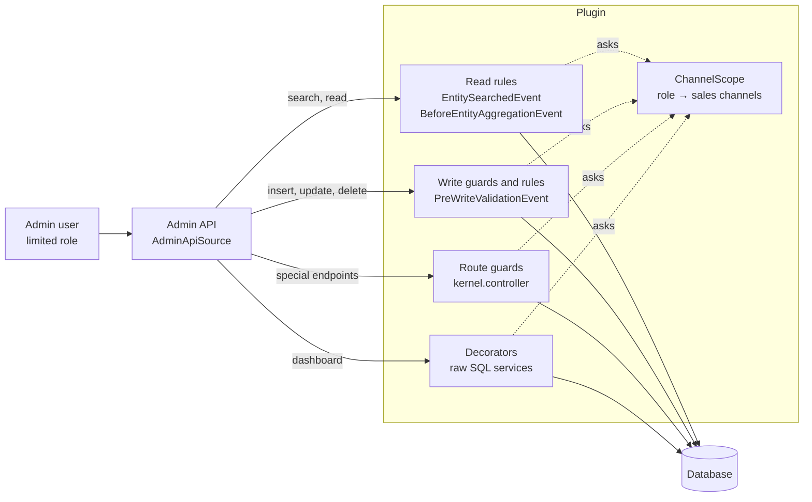

# Architecture

How the plugin limits admin users to sales channels: who is limited, how each entity belongs to a sales channel, and where each rule is enforced.

- [Who is limited](#who-is-limited)
- [How each entity belongs to a sales channel](#how-each-entity-belongs-to-a-sales-channel)
- [Where the rules are enforced](#where-the-rules-are-enforced)
- [Channel scope](#channel-scope)
- [Read filter](#read-filter)
- [Write guard](#write-guard)
- [Paths around the data layer](#paths-around-the-data-layer)
- [Shopping Experiences](#shopping-experiences)
- [Promotions](#promotions)
- [Configuration values](#configuration-values)
- [Totals and dashboard](#totals-and-dashboard)
- [Administration](#administration)
- [Limitations](#limitations)
- [Code map](#code-map)

## Who is limited

A user is limited when **every** role they have is limited to sales channels. Their channels are the union of their roles' channels.

| User or caller | Limited? | Why |
|---|---|---|
| Admin user (`admin = true`) | no | admins can do everything, as in Shopware |
| User whose roles all have sales channels | **yes**, to the union of those channels | |
| User with at least one role without sales channels | no | a role without channels means "all channels", as before the plugin |
| Integration (API key) | no | not covered yet |
| Storefront, Store API, CLI | no | not an admin user |
| Work in the system scope (indexing, scheduled tasks, flows, internal reads) | no | runs on behalf of Shopware, not of a user |

Nothing changes for existing setups: until a role gets sales channels, the plugin does nothing.

## How each entity belongs to a sales channel

The principle: **with a scope, you only see what is connected to your sales channels.** Only orders belong to exactly one sales channel. Most other records are shared or linked indirectly, so the rules distinguish **seeing** a record from **changing** it: a record also connected to other channels is read-only, because a change would affect those channels too.

| Entity | Link to the sales channel | Sees it | Changes it |
|---|---|---|---|
| Orders | `order.salesChannelId`, exactly one | its channel is the user's | the same, and it can't move to another channel |
| Order details (line items, deliveries, transactions, addresses, order customer, documents) | through their order | as their order | as their order |
| Customers | `salesChannelId` (registered in), optional `boundSalesChannelId` | registered in, bound to **or ordered in** one of the user's channels | registered in or bound to one of the user's channels |
| Customer addresses | through their customer | as their customer | as their customer |
| Sales channels | the channel itself | the user's channels | update only; never create or delete |
| What a sales channel offers (countries, currencies, languages, payment and shipping methods, translations, theme assignment), analytics, product comparison, files | `sales_channel_id`, or the channel that uses it (analytics) | of the user's channels | of the user's channels |
| Products | `product_visibility`; variants use their parent's | sold in one of the user's channels | sold only in the user's channels; the user's own visibilities can always change |
| Product details (prices, media, visibilities, configurator, cross-selling, downloads, search keywords, translations) | through their product | as their product | as their product |
| Product reviews, review summaries (Commercial) | `salesChannelId` | its channel is the user's | the same |
| Categories | none; channels point to entry categories (navigation, footer, service) | in a tree of one of the user's channels, plus the ancestors of their entries | belongs to the user's channels only |
| Shopping Experiences | none; derived from what uses the layout | used in one of the user's channels, created by them and unused, or locked | used only within the user's channels |
| Landing pages | `landing_page_sales_channel` | shown in one of the user's channels | shown only in the user's channels |
| Promotions | `promotion_sales_channel` | assigned to one of the user's channels | assigned only to the user's channels |
| Newsletter recipients | `salesChannelId` | its channel is the user's | the same |
| Configuration values, SEO URLs and templates, domains | `salesChannelId`, or none for all channels | of the user's channels, and those for all channels | of the user's channels only |
| Themes | `theme_sales_channel` | all | configuration only when used by the user's channels only |
| Rules, payment and shipping methods | none; they apply to all channels | all | rules: only new ones; payment and shipping methods: never |

Customers are the subtle case. A customer registered in channel B who also ordered in channel A is visible to the team of channel A, because they handle that customer's orders in A. Only the team of channel B may change the customer, because the account belongs to channel B.

## Where the rules are enforced

A plugin can't change the ACL itself, but every admin screen, the Admin API and the Sync API go through the data layer:



- **Read filter:** filtering in the data layer instead of the UI means a hidden record is also hidden from search, the API and every screen.
- **Write guard:** checks every insert, update and delete before it is written, against the stored record (who it belongs to now) and the payload (who it would belong to afterwards).
- **Route guards and decorators:** a few endpoints bypass the data layer (plain SQL, system scope, raw existence checks). Each needs its own guard; see [paths around the data layer](#paths-around-the-data-layer).

## Channel scope

`ChannelScope::salesChannelIds(Context)` answers one question for every other part: which sales channels may this caller see? It returns a list of ids (hex), or `null` for unrestricted. Roles are loaded through `RoleChannelLoader` (`DbalRoleChannelLoader`, table `mn_acl_role_sales_channel`) once per user and request.

The table maps ACL roles to sales channels. `AclRoleExtension` adds it to the role as the many-to-many association `acl_role.mnSalesChannels`, so the role page loads and saves it with the role.

## Read filter

`ReadFilterSubscriber` listens to `EntitySearchedEvent` and `BeforeEntityAggregationEvent`, which Shopware dispatches for every repository search, id search and aggregation. For a limited user it asks every **read rule** (services tagged `mn_channel_scope.read_rule`, see [extending](extending.md#read-and-write-rules)) for a filter and adds all of them (AND).

The built-in rules are in `ScopeRules`:

| Entity | Filter |
|---|---|
| `sales_channel` | `id IN (user's channels)` |
| `order` | `salesChannelId IN (…)` |
| order details | `order.salesChannelId IN (…)` |
| `customer` | `salesChannelId IN (…) OR boundSalesChannelId IN (…) OR orderCustomers.order.salesChannelId IN (…)` |
| `customer_address` | the customer rule through `customer.` |
| `product` | `visibilities.salesChannelId IN (…) OR parent.visibilities.salesChannelId IN (…)` |
| product details | the product rule through `product.` |
| `product_review`, `product_review_summary`, `main_category` | `salesChannelId IN (…)` |
| `category` | entry categories and their ancestors, or `path` contains an entry category (`CategoryTrees`) |
| `cms_page`, `cms_section`, `cms_block`, `cms_slot` | the visible layouts (`CmsPages`), through `pageId`, `section.pageId`, `block.section.pageId` |
| `landing_page` | `salesChannels.id IN (…)` |
| `promotion` and its parts | `salesChannels.salesChannelId IN (…)`, parts through `promotion.` |
| what a sales channel offers | `salesChannelId IN (…)` |
| configuration values, SEO URLs and templates, domains, product comparison, files | `salesChannelId IN (…) OR salesChannelId IS NULL`; configuration values also limited to readable domains |

Newsletter recipients use the generic `SalesChannelColumnRule`, the same class other plugins use for their entities.

Associations need extra care: Shopware loads to-many associations (a customer's addresses, an order's line items) without a search event of their own. The subscriber walks the criteria's associations and adds the rules to every to-many association, at any depth. Many-to-one and one-to-one associations are joins and can't take a filter; their entity is filtered whenever it is searched directly.

## Write guard

`PreWriteValidationEvent` carries every command of a write (also Sync API batches, nested writes and versioned writes). The built-in guards check the plugin's own entities; **write rules** (services tagged `mn_channel_scope.write_rule`) are the extension point for other entities.

| Guard | Covers |
|---|---|
| `WriteGuardSubscriber` | orders, customers, sales channels and what they offer, the role mapping, products, reviews, categories, landing pages, configuration values, themes, rules, payment and shipping methods |
| `CmsGuardSubscriber` | layouts, their sections, blocks, slots and translations; layouts assigned to categories, products, landing pages |
| `PromotionGuardSubscriber` | promotions and everything that belongs to them |
| `WriteRuleSubscriber` | every tagged write rule (newsletter recipients, other plugins' entities) |

Records inserted in the same write (an order with its line items, a promotion with its sales channel assignment) are checked against each other, so creating them together works. Stored values are read with plain SQL lookups (`DbalScopeLookup`, `DbalCmsUsageSource`, `DbalPromotionSource`, `DbalChannelColumnLookup`).

A refusal is reported as Shopware's write error (HTTP 400):

```json
{ "code": "MN_CHANNEL_SCOPE__WRITE_DENIED", "detail": "Your role may not change this order: the order belongs to another sales channel" }
```

## Paths around the data layer

Some core endpoints check or change records without the events the read filter and write guard hook into. Each one needs its own guard:

| Endpoint | Gap | Guard |
|---|---|---|
| *Log in as customer* (`POST /api/_proxy/generate-imitate-customer-token`) | validates customer and channel with a raw existence check | `ImitateCustomerGuardSubscriber`: own channel, customer registered in or bound to it |
| Settings (`/api/_action/system-config`, `/batch`) | reads and writes configuration values with plain SQL | `SystemConfigGuardSubscriber`, see [configuration values](#configuration-values) |
| Clone (`POST /api/_action/clone/{entity}/{id}`) | reads the source without search events, writes the copy in the system scope | `CloneGuardSubscriber`: the source must be visible; products only when sold in the user's channels only; copies of layouts belong to the user's channels |
| Promotion codes (`/api/_action/promotion/codes/replace-individual`, `add-individual`) | replacing deletes the old codes with plain SQL first | `PromotionGuardSubscriber`: own promotions only |
| Theme assignment and configuration (`/api/_action/theme/...`) | the assignment writes the pending theme with plain SQL and may switch asynchronously; configuration routes check no privilege | `ThemeGuardSubscriber` |
| Dashboard turnover | plain SQL | `ScopedOrderAmountService` |
| Admin search (`POST /api/_admin/search`), order state transitions, Store API proxy, admin order creation | none needed: they read through the repositories | – |
| Import/Export | the presets don't grant it; export jobs run with the user's context, so the read filter applies (not tested end to end) | – |
| Admin search with OpenSearch | results are filtered, the hit count comes from the index (not tested) | – |

## Shopping Experiences

A layout has no sales channel of its own. `CmsPages` derives its channels from what uses it (`DbalCmsUsageSource`, one set of queries per request):

- categories: the channels whose trees hold the category;
- products and variants: their visibilities;
- landing pages: their sales channels;
- default layout settings (`core.cms.default_*`): all channels, or the one they are set for;
- owners: a layout created by a limited user belongs to that user's channels (`mn_cms_page_sales_channel`, recorded in the same transaction). This keeps a new, still unused layout, and a copy of a shared layout, with its team.

Visible: Shopware's locked layouts and layouts with one of the user's channels. Editable: not locked and only the user's channels. In the editor, a shared layout behaves like a locked one.

## Promotions

A promotion belongs to the channels it is assigned to (`promotion_sales_channel`). Shared promotions are read-only; everything that belongs to a promotion (discounts with prices and rules, set groups, individual codes, conditions, persona customers, translations) follows it. A new promotion needs an assignment to one of the user's channels in the same write. Shopware's form for a new promotion has no sales channels, so the administration assigns the user's channels when they save.

Shopware's promotion editor role also allows changing rules, payment and shipping methods (for the rule builder in the promotion conditions). Those apply to all channels: limited users may create new rules with their conditions, but not change existing rules, payment or shipping methods.

## Configuration values

Configuration values (`system_config`) exist per sales channel and for all channels. `ConfigRules` decides from `SettingsDomains` (Shopware's own and those other plugins register):

- **readable:** Shopware's settings (`core.*`) and the storefront's theme bookkeeping, of the user's channels and for all channels (the administration shows those as inherited values), except credentials and installation-wide domains (mailer, store and license, apps, services, updates, usage data, webhooks);
- **editable:** the pages of the *Sales channel settings* preset (basic information, cart, login and registration, newsletter, sitemap), only for the user's own channels.

The settings API reads and writes with plain SQL, so `SystemConfigGuardSubscriber` checks those routes (refusals: HTTP 403, `MN_CHANNEL_SCOPE__SETTINGS_DENIED`); the read filter and write guard apply the same rules to the entity API.

## Totals and dashboard

Shopware stores some totals across all sales channels: on the customer `orderCount`, `orderTotalAmount`, `lastOrderDate` and `reviewCount`, on the product `ratingAverage` and `sales`. For a limited user, `ChannelTotalsSubscriber` replaces them when customers or products are loaded with totals counted in the user's channels (`DbalChannelTotals`, same rules as Shopware). Filtering and sorting by these fields still use the stored totals.

The dashboard's turnover chart comes from `OrderAmountService`, which queries with plain SQL; `ScopedOrderAmountService` decorates it and limits the query for limited users.

## Administration

The administration extensions only help the user; every rule is enforced on the server.

| Component | What it does for limited users |
|---|---|
| `sw-users-permissions-role-detail`, `-role-view-general` | role page: the role's sales channels and the permission presets card |
| `sw-product-detail` | shared products: read-only hint, every field disabled; new products start with the user's channels |
| `sw-category-detail`, `sw-category-view` | shared categories: read-only hint, every field disabled |
| `sw-cms-detail` | shared layouts look like locked ones |
| `sw-promotion-v2-detail` | new promotions get the user's channels |
| `sw-admin-menu`, `sw-settings-index` | *Settings* only with the settings preset, and only the preset's pages; other settings pages redirect to the dashboard |
| `sw-sales-channel-switch`, `sw-system-config`, `sw-seo-url-template-card`, `sw-settings-seo` | no *All Sales Channels* option; inherited values and default templates load first; settings that only exist for all channels are hidden |

"Every field disabled" works through Shopware's own `acl` service: while a shared record is open, `acl.can()` answers *no* for the module's editor, creator and deleter roles (`registerReadOnlyGuard`), so Shopware's fields disable themselves as for a view-only user.

The screens get the scope from `GET /api/_action/mn-channel-scope/me` (`{ restricted, salesChannelIds, categoryEntryPoints }`) and `GET /api/_action/mn-channel-scope/cms-page/{id}`. Other plugins use the same through `Shopware.Service('mnChannelScope')`, see [extending](extending.md#administration).

## Limitations

| Gap | Effect | Possible fix |
|---|---|---|
| Integrations (API keys) | never limited | a channel setting for integrations |
| Commercial features (B2B, Return Management, Subscriptions, Multi-Warehouse) | their entities are not limited | read and write rules per entity |
| Flow Builder, mail previews, Import/Export (when granted) | not tested end to end | |
| Rules created by limited users | can't be changed afterwards (rules have no sales channel) | owners like layouts |
| Commercial's Shopping Experience extensions (scroll navigation, quick view, block rules) | not checked | follow their layout |
| Layout list actions (delete, set as default) on shared layouts | offered; refused on save | hide them in the list |
| Category tree actions, product bulk edit, variant generator, list inline edit | not marked read-only; refused on save | mark them in the UI |
| Category child counts | an expand arrow for categories whose children are all hidden | count visible children |
| Product cross-selling assigned products | not checked | check through their cross-selling |
| Settings pages beyond the preset (listing, documents, number ranges, plugin configuration) | only for unrestricted users | open them one by one where they are per channel |
| Filtering and sorting by customer or product totals | uses Shopware's totals across all channels | a per-channel totals table |
| Many-to-one joins | a joined record is shown where another record references it (a review's customer) | accept the label; the record itself stays hidden |
| Other plain SQL endpoints (statistics, reports) | may show figures of all channels | decorate them one by one |
| Performance | the customer rule adds joins per customer search | cache or denormalise if needed |

## Code map

```
src/
  Scope/       ChannelScope, RoleChannelLoader (who is limited), ScopeRules (built-in read rules),
               ConfigRules, SettingsDomains (configuration values)
  Rule/        ReadRule, WriteRule, WriteScope, SalesChannelColumnRule: the extension point
  Subscriber/  read filter, write guards, route guards, totals
  Category/    CategoryTrees: which categories belong to which channels
  Cms/         CmsPages: which channels a layout belongs to
  Promotion/   PromotionSource: stored promotion facts
  Write/       ScopeLookup: stored channels of records that change
  Totals/, Dashboard/                per-channel totals and turnover
  Preset/, Command/                  permission presets
  Controller/                        endpoints for the administration
  Entity/, Extension/, Migration/    role and layout mappings
  Resources/config/presets/          preset files
  Resources/app/administration/      administration extensions and services
bin/expand-preset.js                 regenerates a preset's expanded privileges
tests/Unit/, tests/js/               unit tests (no database needed)
```
